# Hi, I'm Chalil Al Vareel 👋

**Back-End Developer · Machine Learning & Data Science**

I'm a Computer Science graduate from Universitas Sumatera Utara who enjoys
building APIs and exploring practical applications of machine learning.

My recent work includes healthcare APIs and AI-assisted tourism recommendations
for North Sumatra. I am interested in back-end architecture, API integration,
machine learning, and turning data into useful applications.

[LinkedIn](https://www.linkedin.com/in/cavareel) ·
[Instagram](https://www.instagram.com/cavareel/) ·
[Email](mailto:chalilalvareel@gmail.com) ·
[CV](https://docs.google.com/document/d/1kXhUMEexver0FSE25DaVINHaUIGbC4dr4FOnENK3AS4/edit?usp=sharing)

## What I Work With

**Back-end and APIs**

**Machine learning and data**

I also work with tools including Keras, Matplotlib, SciPy, Oracle Database,
Apache Spark, R, and Git.

## Selected Projects

**RetinEye**  
A thesis project that uses a deep learning model to classify eye conditions
from fundus images, with a Flask API for testing.

[View repository](https://github.com/lilreel/retineye)

**Swalokal**  
A Bangkit Academy capstone project involving image data collection and
transfer learning for model development.

[View repository](https://github.com/lilreel/Machine-Learning)

**Home Credit Default Risk**  
A machine learning project exploring supervised learning models, data
preparation, and hyperparameter tuning.

[View project](https://github.com/lilreel/KampusMerdika_StudiIndependen_Zenius_AcceleratedMLProgram/tree/main/Projek%20Akhir)

## GitHub Activity

  
  

