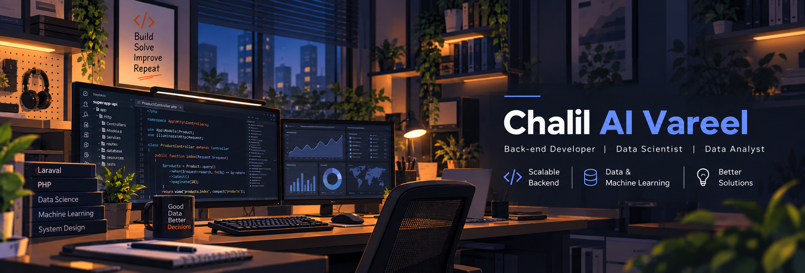

  

<h1 align="center">
  Hi, I'm Chalil Al Vareel
  
</h1>

  

  </a>
    

  
  
  
  <a href="https://docs.google.com/document/d/1rtKnqQO5egYKJTizQU1E5miM5U0pKv-YLsXmFgoR3KA/edit?usp=sharing">
    

## About Me

I'm a Computer Science graduate from **Universitas Sumatera Utara**. I enjoy
building back-end services, connecting APIs, and exploring practical uses for
machine learning.

My work with **Dinas Komunikasi dan Informatika Provinsi Sumatera Utara**
includes contributions to public-sector digital services related to healthcare,
tourism, and public information. I focus on back-end development, API
integration, content management, and AI-assisted applications.

## Technologies & Tools

**Back-End and APIs**

  
  
  
  
  
  
  

**Machine Learning and Data**

  
  
  
  
  
  

**Also familiar with:** 

  
  
  
  
  
  
  
  

## Selected Projects

### [RetinEye](https://github.com/lilreel/retineye)

A thesis project that classifies eye conditions from fundus images using a
deep learning model, with a Flask API for testing.

`Python` `TensorFlow` `Flask` `Transfer Learning`

### [Swalokal](https://github.com/lilreel/Machine-Learning)

A Bangkit Academy capstone project involving image data collection and
transfer learning for model development.

`Python` `TensorFlow` `Computer Vision` `Transfer Learning`

### [Home Credit Default Risk](https://github.com/lilreel/KampusMerdika_StudiIndependen_Zenius_AcceleratedMLProgram/tree/main/Projek%20Akhir)

A team project exploring supervised learning models for loan default risk,
including data preparation and hyperparameter tuning.

`Python` `Pandas` `LightGBM` `Supervised Learning`

## Recognition

  
  

## GitHub Activity

  
<b>GitHub statistics and language breakdown</b>

   

  

    
    
  

  
<b>Recent contribution activity</b>

   

  

    
  

## Let's Connect

I'm always interested in back-end development, machine learning, and useful
data-driven applications.

Connect with me on [LinkedIn](https://www.linkedin.com/in/cavareel) or
[email](mailto:chalilalvareel@gmail.com).
